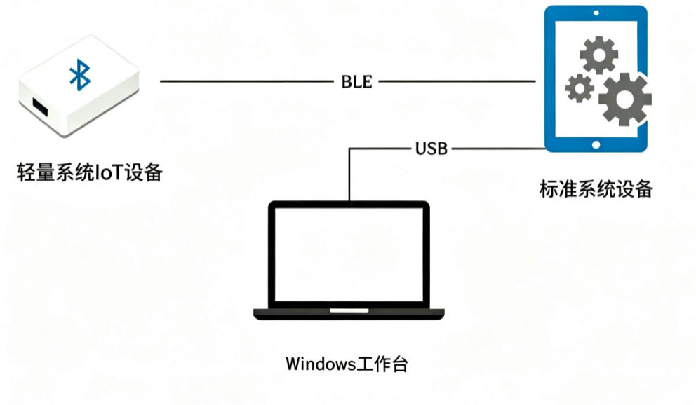
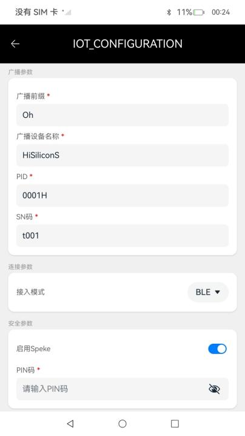
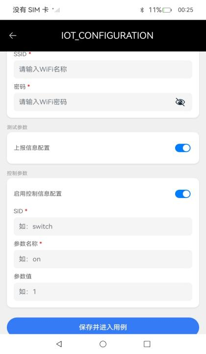

# 轻量系统IoTC兼容性测试指导

## 测试组网

对轻量系统设备的IoTC测试需要借助一台标准系统设备完成，标准系统设备会安装测试应用，基于BLE蓝牙协议连接被测IoT设备，创建BLE会话，对轻量系统IoT设备进行兼容性测试。



1. Windows工作台：运行测试框架，通过USB与标准系统设备通信，控制测试执行流程并收集测试结果。
2. 标准系统设备：安装IoTC测试应用，作为测试执行的主体。通过USB线连接Windows工作台，并通过BLE连接轻量系统IoT设备，执行设备发现、连接、服务查询、指令控制及配网等测试用例。
3. 轻量系统IoT设备：被测IoT设备，作为被控端。通过BLE广播自身信息，响应标准系统设备发起的连接请求、服务查询和控制指令。

## 测试用例编译指导

在test/xts/acts目录下执行编译命令(以标准设备rk3568为例)：
```
./build.sh product_name=rk3568 system_size=standard suite=iotc_validator_test
```

测试应用输出目录：out/rk3568/suites/acts/iotc-validator/testcases

测试框架&用例整体输出目录：out/rk3568/suites/acts/iotc-validator（编译用例时会同步编译测试套执行框架）

## 测试执行指导

### 搭建和启动测试执行环境

#### 安装Python环境

搭建测试环境，Windows工作台下安装python3.7及以上版本，确保工作台和测试设备正常连接。

**注：高版本python不带 easy_install，可以安装低于 52.0.0 的 setuptools，解决该问题。**

```
pip install setuptools==50.0.0
```

#### 启动测试套件

测试执行目录（对应编译生成的out/rk3568/suites/acts/iotc-validator目录）

    ├── testcases                       # 测试套文件存放目录 
    │ └──iotc_validator.hap                       # 测试套可执行hap文件
    │ └──iotc_validator.json                      # 测试套对应执行配置文件
    ├── tools                          # 测试框架工具目录
    ├── run.bat                        # window平台测试套启动执行文件
    ├── reports                         # 测试报告生成目录

用例执行
1.  在Windows工作台上，找到从Linux服务器上拷贝下来的测试套件用例目录，在Windows命令窗口进入对应目录，直接执行run.bat。

2.  控制台界面启动后，执行：```run validator -ta update:true``` 启动测试应用，控制台输出“Is test finished? Y/N”时，表示可以开始进行测试。

### 执行测试用例

#### 1. 测试配置

进入测试应用 ，首页点击“IOT_CONFIGURATION”进入测试配置


配置IoTC测试相关信息，配置字段说明和获取方法参考下文：

   

<table>
<thead>
<tr>
<th><strong>区域</strong></th>
<th><strong>参数</strong></th>
<th><strong>说明</strong></th>
</tr>
</thead>
<tbody>
<tr>
<td rowspan="4">广播参数</td>
<td>广播前缀</td>
<td> 固定前缀（“Oh”或“Oc”），作为设备识别的标识吗，必填</td>
</tr>
<tr>
<td>广播设备名称</td>
<td>最多 10 字节，必填</td>
</tr>
<tr>
<td>PID</td>
<td>5 位设备 PID，必填</td>
</tr>
<tr>
<td>SN码</td>
<td>设备序列号 SN 的后四位，必填</td>
</tr>
<tr>
<td>连接参数</td>
<td>接入模式</td>
<td>BLE / SLE / COAP / SoftAP<br>根据设备支持的协议选择，当前仅支持BLE</td>
</tr>
<tr>
<td>安全参数</td>
<td>启用 Speke</td>
<td>配置开关，开启后需输入 PIN 码</td>
</tr>
<tr>
<td>配网参数</td>
<td>启用 WiFi 配置</td>
<td>配置开关，开启后需输入SSID和密码，填写待连接路由器的WiFi名称和密码</td>
</tr>
<tr>
<td>测试参数</td>
<td>上报信息配置</td>
<td>配置开关，控制是否执行设备信息上报，开启后执行allservices服务查询</td>
</tr>
<tr>
<td>控制参数</td>
<td>启用控制信息配置</td>
<td>配置开关，开启后需输入SID/参数名/参数值</td>
</tr>
</tbody>
</table>


注：
1. 广播参数格式可参考[https://www.giiconsortium.org/2025/post/2506/](https://www.giiconsortium.org/2025/post/2506/) 6.1.2 BLE设备发现章节中，关于AD Structure2字段的格式要求。
2. “启用WiFi配置”与“上报信息配置”需至少支持一项，配置页面已按照该规则进行限制。

配置完成后，点击“保存并进入用例”按钮，进入测试主页面。

应用根据以下配置规则自动过滤测试用例列表：

<table>
<thead>
<tr>
<th><strong>配置条件</strong></th>
<th><strong>显示的用例</strong></th>
<th><strong>说明</strong></th>
</tr>
</thead>
<tbody>
<tr>
<td>必选（不受配置影响）</td>
<td>SUB_IOT_DISCOVERY_BLE_0100（设备发现）<br>SUB_IOT_CONNECT_BLE_0100（设备连接）</td>
<td>设备发现和连接为必测用例</td>
</tr>
<tr>
<td>Speke开启</td>
<td>SUB_IOT_CONNECT_BLE_0100（设备连接）</td>
<td>Speke开启时，该用例会使用PIN码与被测设备进行Speke协商，否则跳过该步骤</td>
</tr>
<tr>
<td>启用WiFi配置开启</td>
<td>SUB_IOT_NETCFG_0100（配网）</td>
<td>启用WiFi配置开启时，该用例为必测用例</td>
</tr>
<tr>
<td>上报信息配置开启</td>
<td>SUB_IOT_QUERY_SERVICE_BLE_0100（服务查询）</td>
<td>上报信息配置开启时，该用例为必测用例</td>
</tr>
<tr>
<td>启用控制信息配置开启</td>
<td>SUB_IOT_SEND_CMD_BLE_0100（发送指令）</td>
<td>启用控制信息配置开启时，该用例为必测用例</td>
</tr>
</tbody>
</table>

#### 2. 手工执行测试

应用根据配置，自动过滤出需要执行的测试用例列表，页面显示如下图所示：


逐条点击进入测试用例，根据指导执行测试（测试指导可点击“?”按钮查看），并观察结果是否符合预期。根据结果点击“Pass”/“Fail”按钮，完成该条用例测试。

#### 3. 自动执行测试

测试人员也可以选择自动执行测试，自动执行用例的测试点和手动执行测试点完全一致。点击“自动执行用例”按钮进入自动测试页面，页面显示如下图所示：


点击“开始执行”按钮，执行完成后结果显示如下图所示（分别对应执行通过和执行失败的页面显示效果）：

   

#### 4. 获取测试报告

用例全部测试完成后，点击页面右上角的“保存”按钮。在Windows控制台输入 ```Y```，结束测试。报告自动生成到reports目录下。