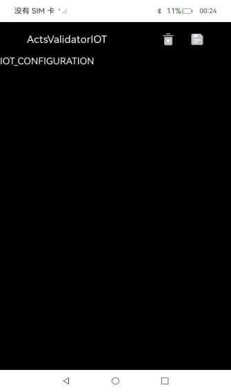
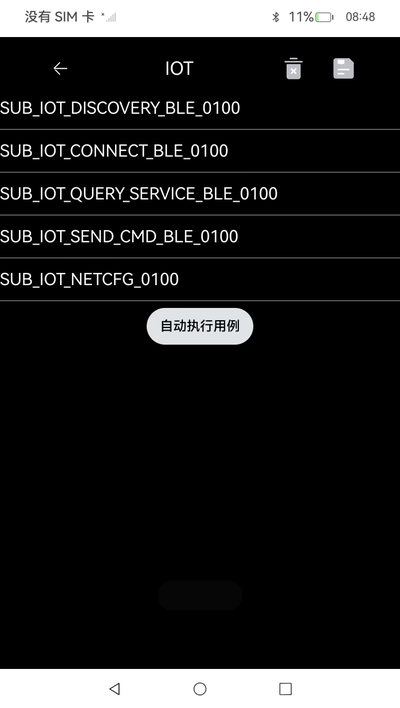
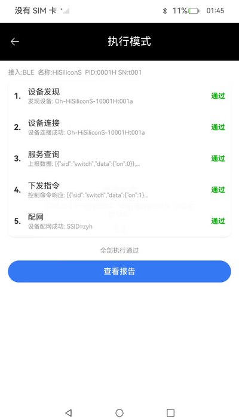
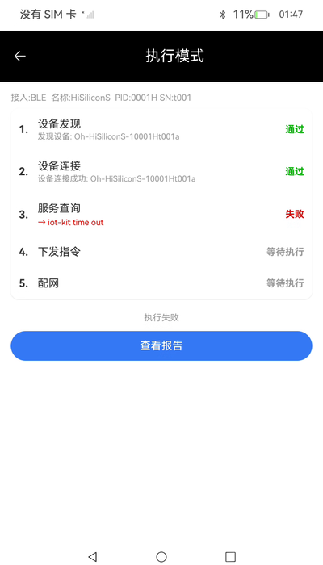

# 轻量系统IoTC兼容性测试指导

## 测试用例编译指导

在test/xts/acts目录下执行编译命令(以标准设备rk3568为例)：
```
./build.sh product_name=rk3568 system_size=standard suite=iotc_validator_test
```

测试应用输出目录：out/rk3568/suites/acts/iotc-validator/testcases

测试框架&用例整体输出目录：out/rk3568/suites/acts/iotc-validator（编译用例时会同步编译测试套执行框架）

## 测试执行指导

### 搭建和启动测试执行环境

#### 安装Python环境

搭建测试环境，Windows工作台下安装python3.7及以上版本，确保工作台和测试设备正常连接。

**注：高版本python不带 easy_install，可以安装低于 52.0.0 的 setuptools，解决该问题。**

```
pip install setuptools==50.0.0
```

#### 启动测试套件

测试执行目录（对应编译生成的out/rk3568/suites/acts/iotc-validator目录）

    ├── testcases                       # 测试套文件存放目录 
    │ └──iotc_validator.hap                       # 测试套可执行hap文件
    │ └──iotc_validator.json                      # 测试套对应执行配置文件
    ├── tools                          # 测试框架工具目录
    ├── run.bat                        # window平台测试套启动执行文件
    ├── reports                         # 测试报告生成目录

用例执行
1.  在Windows工作台上，找到从Linux服务器上拷贝下来的测试套件用例目录，在Windows命令窗口进入对应目录，直接执行run.bat。

2.  控制台界面启动后，执行：```run validator -ta update:true``` 启动测试应用，控制台输出“Is test finished? Y/N”时，表示可以开始进行测试。

### 执行测试用例

#### 1. 测试配置

进入测试应用 ，首页点击“IOT_CONFIGURATION”进入测试配置



配置IoTC测试相关信息，配置字段说明和获取方法参考下文：

   

<table>
<thead>
<tr>
<th><strong>区域</strong></th>
<th><strong>参数</strong></th>
<th><strong>说明</strong></th>
</tr>
</thead>
<tbody>
<tr>
<td rowspan="4">广播参数</td>
<td>广播前缀</td>
<td>如 Oh / Oc ，必填</td>
</tr>
<tr>
<td>广播设备名称</td>
<td>最多 10 字符<br>必填,厂商提供</td>
</tr>
<tr>
<td>PID</td>
<td>5 位设备 PID<br>必填，厂商提供</td>
</tr>
<tr>
<td>SN码</td>
<td>后 4 位设备 SN<br>必填，厂商提供</td>
</tr>
<tr>
<td>连接参数</td>
<td>接入模式</td>
<td>BLE / SLE / COAP / SoftAP<br>目前只支持BLE</td>
</tr>
<tr>
<td>安全参数</td>
<td>启用 Speke</td>
<td>开关，开启后需输入 PIN 码</td>
</tr>
<tr>
<td>配网参数</td>
<td>启用 WiFi 配置</td>
<td>开关，开启后需输入SSID和密码</td>
</tr>
<tr>
<td>测试参数</td>
<td>上报信息配置</td>
<td>开关，控制是否执行设备信息上报</td>
</tr>
<tr>
<td>控制参数</td>
<td>启用控制信息配置</td>
<td>开关，开启后需输入SID/参数名/参数值</td>
</tr>
</tbody>
</table>

注：广播参数格式可参考[https://www.giiconsortium.org/2025/post/2506/](https://www.giiconsortium.org/2025/post/2506/) 6.1.2 BLE设备发现章节中，关于AD Structure2字段的格式要求。

配置完成后，点击“保存并进入用例”按钮，进入测试主页面。

#### 2. 手工执行测试

应用根据配置，自动过滤出需要执行的测试用例列表，页面显示如下图所示：



逐条点击进入测试用例，根据指导执行测试（测试指导可点击“?”按钮查看），并观察结果是否符合预期。根据结果点击“Pass”/“Fail”按钮，完成该条用例测试。

#### 3. 自动执行测试

测试人员也可以选择自动执行测试，自动执行用例的测试点和手动执行测试点完全一致。点击“自动执行用例”按钮进入自动测试页面，页面显示如下图所示：


点击“开始执行”按钮，执行完成后结果显示如下图所示（分别对应执行通过和执行失败的页面显示效果）：

   

#### 4. 获取测试报告

用例全部测试完成后，点击页面右上角的“保存”按钮。在Windows控制台输入 ```Y```，结束测试。报告自动生成到reports目录下。